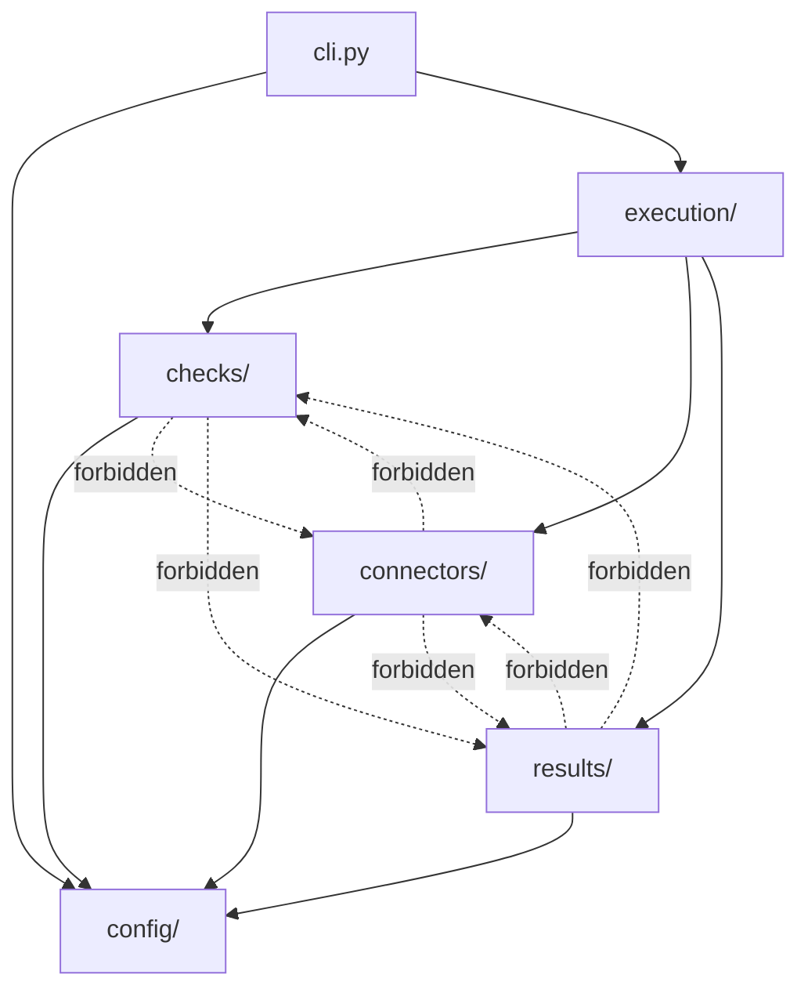
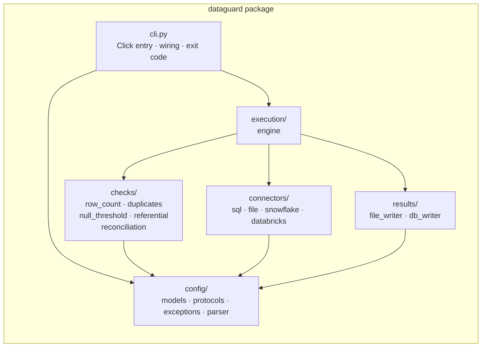
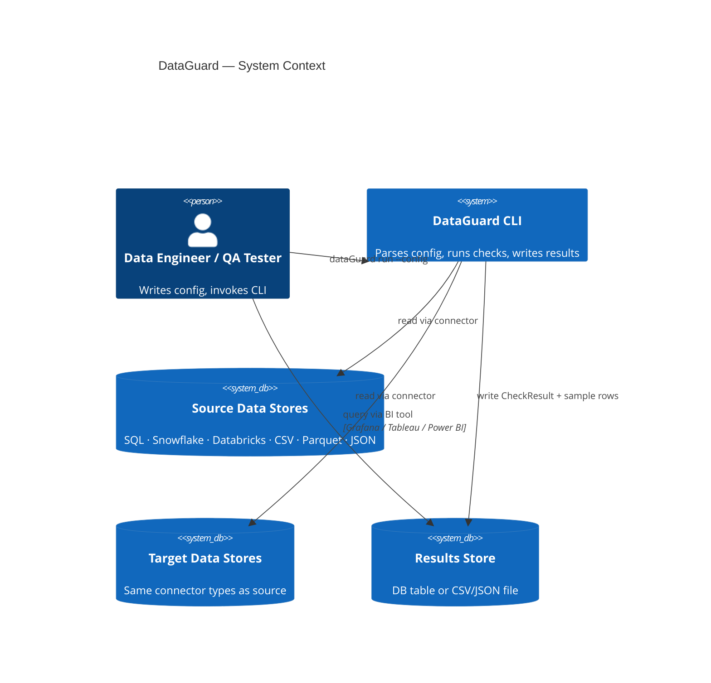

# Architecture Spine — DataGuard

## Design Paradigm

**Hexagonal (Ports and Adapters).** The domain core is pure; all I/O is behind ports.

| Layer | Namespace | Role |
| --- | --- | --- |
| Driver | `dataguard/cli.py` | Click entry point; wires all layers; owns exit code |
| Application | `dataguard/execution/` | Orchestrates a run; holds no domain logic |
| Domain | `dataguard/checks/`, `dataguard/config/` | Pure check functions + shared data shapes + typed config models |
| Port | `BaseConnector`, `ResultsWriter` | Contracts that keep the domain ignorant of I/O — both defined in `config/protocols.py` |
| Adapters (outbound) | `dataguard/connectors/`, `dataguard/results/` | All concrete I/O implementations |

## Invariants & Rules

### AD-1 — Paradigm: Hexagonal / Ports-and-Adapters

- **Binds:** all modules
- **Prevents:** domain logic (checks) importing from connectors or results; execution engine bypassing ports to call adapters directly
- **Rule:** `dataguard/checks/` has zero imports from `dataguard/connectors/` or `dataguard/results/`; the execution engine (`execution/engine.py`) imports only from `config/` — never from `connectors/` or `results/` directly, including exception types (see AD-11)

### AD-2 — Connector port: `BaseConnector.read() → DataFrame`

- **Binds:** `dataguard/connectors/`, `dataguard/checks/`, `dataguard/execution/`
- **Prevents:** check functions knowing which data store they are reading from
- **Rule:** every connector implements `BaseConnector` (defined in `config/protocols.py`); its only contract with the rest of the system is `read(query_or_path: str, params: dict) → pd.DataFrame`; check functions receive DataFrames, never connector objects

### AD-3 — Check types: stateless pure functions

- **Binds:** `dataguard/checks/`
- **Prevents:** check functions holding state, connections, or performing writes
- **Rule:** each check type is a module-level function `(config: CheckConfig, source_df: DataFrame, target_df: DataFrame | None) → (CheckResult, DataFrame | None)`; no side effects; no external calls; the return value is the complete output

### AD-4 — Results port: `ResultsWriter` protocol with typed `validate()` contract

- **Binds:** `dataguard/results/`, `dataguard/execution/`, `dataguard/cli.py`
- **Prevents:** the execution engine knowing whether output goes to a DB or a file; ambiguous validate() return shapes across implementations
- **Rule:** `ResultsWriter` is defined in `config/protocols.py`; `validate()` returns `None` and raises `ConfigurationError` (from `config/exceptions.py`) on failure — never returns a boolean; `write(result: CheckResult, sample_df: DataFrame | None)` and `close()` are the only other methods; the engine and cli.py import `ResultsWriter` from `config/protocols.py`, never from `results/`

### AD-5 — Single config parse boundary: Pydantic v2 in `config/parser.py`

- **Binds:** `dataguard/config/`
- **Prevents:** raw dict access to config values outside `config/`; ad-hoc env var resolution in connectors
- **Rule:** `parse_config(path) → ParseResult` is the only entry point for config; raw YAML/JSON never leaves `config/`; all downstream code receives typed Pydantic model instances from `config/models.py`

### AD-6 — Env var resolution at parse time; short-circuit to ERROR at execution time

- **Binds:** `dataguard/config/parser.py`, `dataguard/execution/engine.py`
- **Prevents:** missing-var behavior having two valid interpretations (connector-level failure vs. engine-level short-circuit); `os.environ` calls in connectors
- **Rule:** `parse_config()` substitutes `${VAR_NAME}` values from `os.environ`; fields referencing an unset variable are recorded in `ParseResult.missing_env_vars: list[str]`; the engine short-circuits to an ERROR `CheckResult` for any check whose connector config has a missing variable — without ever instantiating the connector; connectors never call `os.environ`

### AD-7 — Sequential execution; no shared or class-level connector state across checks

- **Binds:** `dataguard/execution/engine.py`, `dataguard/connectors/`
- **Prevents:** a failed check's connection state bleeding into adjacent checks; stale cached credentials surviving across checks
- **Rule:** for each check the engine instantiates a fresh connector, calls `connect()`, calls `read()`, calls `close()` in a try/finally; no connector instance lives beyond one check's execution block; connector implementations must hold **no class-level or module-level mutable state** — all connection state is instance-level and fully released in `close()`

### AD-8 — Cloud SDK extras: guarded optional imports only

- **Binds:** `dataguard/connectors/file.py`
- **Prevents:** `ImportError` at module load time crashing on-prem deployments
- **Rule:** `s3fs`, `adlfs`, `gcsfs` are imported inside `try/except ImportError` blocks at connection time, not at module top-level; a missing extra raises `ConnectorError("Install dataguard[s3] to use S3 sources")` — `ConnectorError` is imported from `config/exceptions.py`

### AD-9 — Results Store validated before first check executes

- **Binds:** `dataguard/cli.py`, `dataguard/results/`
- **Prevents:** silent result loss after a full check run
- **Rule:** `writer.validate()` is called at CLI startup, after config parse and before the engine starts; a `ConfigurationError` from `validate()` aborts with exit 1 and a diagnostic message; no checks execute until validation passes

### AD-10 — Exit code contract owned by `cli.py`

- **Binds:** `dataguard/cli.py`
- **Prevents:** ambiguous CI/CD gate signals
- **Rule:** exit 0 iff every non-SKIP check has status PASS; exit 1 on any FAIL or ERROR; a run consisting entirely of SKIP checks exits 0; the engine returns a list of `CheckResult`, never calls `sys.exit`

### AD-11 — Dependency direction: `config/` is the only shared import target

- **Binds:** all modules
- **Prevents:** circular dependencies; cross-layer coupling; two independent locations for shared data shapes or port definitions
- **Rule:** `checks/`, `connectors/`, and `results/` must not import from each other; all three may import from `config/` only; `cli.py` is the sole wiring point that imports across all layers
- **Sub-rules (close adversarial gaps):**
  - Shared data shapes (`CheckResult`, `CheckConfig` subtypes) live in `config/models.py` — not in the module that first produces them
  - All Protocol/ABC port definitions (`ResultsWriter`, `BaseConnector`) live in `config/protocols.py`
  - Cross-cutting exceptions (`ConnectorError`, `ConfigurationError`) live in `config/exceptions.py`
  - No other module defines a Protocol, ABC, or shared exception class



## Consistency Conventions

| Concern | Convention |
| --- | --- |
| Naming — modules | `snake_case` for all files and packages |
| Naming — public types | `PascalCase` for Pydantic models, dataclasses, ABCs, Protocol |
| Naming — check functions | `run_<check_type>(config, source_df, target_df) → tuple` |
| Naming — connector classes | `<StoreName>Connector` (e.g. `SnowflakeConnector`) |
| Naming — writer classes | `<Format>Writer` (e.g. `FileWriter`, `DatabaseWriter`) |
| Error types | `ConnectorError` for source/target I/O failures; `ConfigurationError` for parse/config/validation failures; both from `config/exceptions.py`; never raise raw library exceptions across layer boundaries |
| Config models | One Pydantic model per check type and per connector type; shared fields (`enabled`, `sample_rows`) on a `BaseCheckConfig` parent in `config/models.py` |
| Result record | `CheckResult` is a `dataclass` in `config/models.py`; all fields populated for every status (PASS/FAIL/SKIP/ERROR); unused fields set to `None`, never omitted |
| File paths | `pathlib.Path` throughout for OS-agnostic separator handling; never bare string concatenation for paths |
| Env var syntax | `${VAR_NAME}` only — no bare `$VAR` or `%VAR%`; cross-platform |
| Check status values | Uppercase string literals: `"PASS"`, `"FAIL"`, `"SKIP"`, `"ERROR"` — no enum, keeps serialization simple |
| Timestamps | ISO-8601 UTC in all Result Records: `datetime.utcnow().isoformat() + "Z"` |
| Logging | `logging` stdlib only; no `print()` in library code; CLI layer calls `print()` for summary output and run progress |

## Stack

*Verify all versions against PyPI before pinning in `pyproject.toml`.*

| Name | Version | Notes |
| --- | --- | --- |
| Python | 3.11+ | 3.9 is EOL (Oct 2025); 3.11 is minimum safe baseline |
| Click | 8.2.x | CLI framework |
| Pydantic | >=2.7 | v2 required; verify current minor on PyPI |
| pandas | >=2.2 | Verify whether 3.0 GA has shipped; pin accordingly |
| SQLAlchemy | >=2.0 | 2.x major; loosen to `>=2.0` rather than `2.0.x` |
| PyYAML | 6.0.x | YAML parsing; no round-trip needed |
| pyodbc | >=5.0 | SQL ODBC connector; verify current on PyPI |
| snowflake-connector-python | >=3.0 | Standard Snowflake pip package |
| databricks-sql-connector | >=3.0 | Python-native; no JVM/JDBC |
| s3fs | >=2024.x *(optional `[s3]`)* | fsspec S3 provider |
| adlfs | >=2024.x *(optional `[azure]`)* | fsspec Azure Blob provider (`abfs://`) |
| gcsfs | >=2024.x *(optional `[gcs]`)* | fsspec GCS provider |
| pytest | >=8.0 | Test runner |
| ruff | latest-stable | Linter + formatter; do not pin to a minor |
| mypy | >=1.11 | Type checker |

## Structural Seed



```text
dataguard/
  cli.py                  # Click entry point; wires all layers; owns exit code
  config/
    __init__.py
    models.py             # Pydantic v2 models: DataguardConfig, CheckResult dataclass, CheckConfig subtypes,
                          #   connection types, OutputConfig — ALL cross-boundary data shapes live here
    protocols.py          # BaseConnector ABC; ResultsWriter Protocol — ALL port definitions live here
    exceptions.py         # ConnectorError; ConfigurationError — ALL shared exceptions live here
    parser.py             # parse_config(path) → ParseResult; env var resolution; ParseResult.missing_env_vars
  connectors/
    __init__.py
    sql.py                # SqlConnector (SQLAlchemy + DBAPI; no JVM/JDBC)
    file.py               # CsvConnector, ParquetConnector, JsonConnector; guarded cloud URI imports
    snowflake.py          # SnowflakeConnector (snowflake-connector-python)
    databricks.py         # DatabricksConnector (databricks-sql-connector; no JVM)
  checks/
    __init__.py
    row_count.py          # run_row_count(config, source_df, target_df) → (CheckResult, None)
    duplicates.py         # run_duplicate_detection(config, source_df) → (CheckResult, sample_df|None)
    null_threshold.py     # run_null_threshold(config, source_df) → (CheckResult, sample_df|None)
    referential.py        # run_referential_integrity(config, source_df, target_df) → (CheckResult, sample_df|None)
    reconciliation.py     # run_reconciliation(config, source_df, target_df) → (CheckResult, None)
  execution/
    __init__.py
    engine.py             # run_all(config, writer) → list[CheckResult]; SKIP/ERROR isolation; summary print
  results/
    __init__.py
    file_writer.py        # FileWriter: CSV/JSON, append/overwrite, output_fields projection, sidecar samples
    db_writer.py          # DatabaseWriter: SQLAlchemy, table auto-create, sidecar _samples table
tests/
  unit/                   # Synthetic DataFrames only; no external connections needed
  integration/            # SQLite for DB checks; local fixture files for file connectors
pyproject.toml            # Package metadata; console_scripts entry point; optional extras
```



## Capability → Architecture Map

| Capability | Lives in | Governed by |
| --- | --- | --- |
| `dataguard/config` — config parsing, env var resolution, validation, all shared types | `config/models.py`, `config/protocols.py`, `config/exceptions.py`, `config/parser.py` | AD-5, AD-6, AD-11 |
| `dataguard/checks` — 5 check type functions | `checks/*.py` | AD-3, AD-2, AD-11 |
| `dataguard/connectors` — 6 connector adapters | `connectors/*.py` | AD-2, AD-7, AD-8, AD-11 |
| `dataguard/execution` — run loop, SKIP/ERROR isolation, summary, exit code | `execution/engine.py`, `cli.py` | AD-1, AD-6, AD-7, AD-9, AD-10 |
| `dataguard/results` — Result Record writes, sample linkage, schema projection | `results/*.py` | AD-4, AD-9, AD-11 |

## Deferred

| Decision | Reason deferred | Revisit when |
| --- | --- | --- |
| Connector connection pooling / reuse across checks | Sequential execution makes pooling unnecessary; adds complexity with no measured benefit | Run times measured in production and found slow due to connection overhead |
| Parallel / async check execution | No use-case established; sequential is simpler and easier to debug | Teams report runs with 20+ checks taking > 10 min |
| Retry policy for transient connection failures | PRD specifies single-attempt ERROR; retry config adds parameter surface | First adopters report false ERRORs from Snowflake warehouse spin-up |
| Dynamic expected values (query-derived reconciliation target) | PRD OQ-3 unresolved; static thresholds cover v1 | Teams request it during v1 onboarding |
| Results Store schema versioning / migration | Explicitly out of v1 | Breaking schema change required |
| Orchestrator-native integrations (Airflow, Databricks Jobs SDK) | PRD §5 out of v1; CLI is the entry point | CLI adoption grows and teams ask for native operators |
| Plugin / extension API for custom check types | Out of v1 scope; extensibility is code-level, not runtime | Multiple teams need non-standard check types |
| Secrets management beyond env vars | Env vars cover v1 | Team with stricter secrets policy adopts DataGuard |
